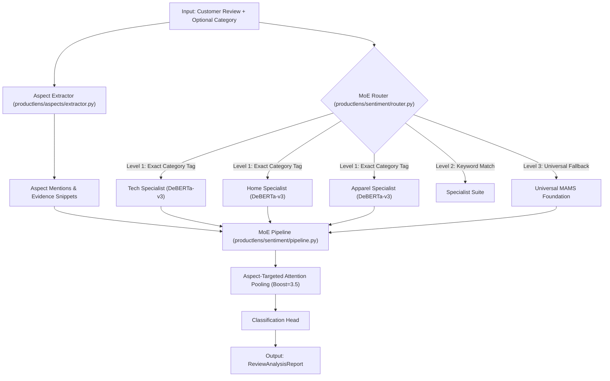

# ProductLens-Sentiment: Architecture & LLM Context Document

## 1. Executive Summary
- **Repository**: [ProductLens-Sentiment](file:///home/parth/Projects/ProductLens-Sentiment)
- **Domain**: Aspect-Based Sentiment Analysis (ABSA) for e-commerce reviews.
- **Core Architecture**: Hierarchical Mixture of Experts (MoE) with domain-specialized DeBERTa-v3 backbones and deterministic $O(1)$ zero-latency metadata routing.
- **Key Task**: Given customer reviews (with optional category metadata), extract aspect targets, route to specialized domain models, and predict aspect-level sentiment labels (Positive, Neutral, Negative) with calibrated confidence scores.

---

## 2. Directory Structure

```
ProductLens-Sentiment/
├── backend/
│   ├── api/
│   │   └── v1/
│   │       ├── analyze.py                # Review analysis REST endpoints
│   │       └── health.py                 # Service health check endpoints
│   ├── schemas/
│   │   └── requests.py                   # Pydantic request & response DTOs
│   └── main.py                           # FastAPI application entry & lifespan manager
├── productlens/
│   ├── aspects/
│   │   └── extractor.py                  # Aspect extraction (noun chunking, gazetteers)
│   ├── sentiment/
│   │   ├── model.py                      # DeBERTa-v3 backbone with aspect-targeted pooling
│   │   ├── pipeline.py                   # MoE batch inference & tokenizer coordinator
│   │   └── router.py                     # 3-tier routing (Metadata -> Keyword -> Fallback)
│   ├── training/
│   │   ├── dataset.py                    # PyTorch Dataset for ABSA tokenization
│   │   ├── loss.py                       # Supervised ABSA loss functions
│   │   └── trainer.py                    # PyTorch fine-tuning trainer
│   ├── engine.py                         # Unified ProductLensEngine facade
│   └── schemas.py                        # Domain dataclasses & schemas
├── configs/
│   ├── app_config.yaml                   # Model weights paths, routing tables, runtime params
│   └── training_configs.yaml             # Hyperparameters for expert fine-tuning
├── data/benchmarks/                      # Benchmark datasets (Tech, Home, Apparel, MAMS)
├── models/category_experts/              # Pretrained / fine-tuned expert weights
├── scripts/                              # Training, evaluation & verification CLI scripts
└── tests/                                # Pytest test suite
```

---

## 3. Pipeline Flow



---

## 4. Key Modules & Symbol Reference

### Engine Facade
- **[`ProductLensEngine`](file:///home/parth/Projects/ProductLens-Sentiment/productlens/engine.py#L52)**: High-level orchestrator.
  - `analyze_review(text: str, category: Optional[str] = None) -> ReviewAnalysisReport`
  - `analyze_batch(texts: List[str], categories: Optional[List[str]] = None) -> BatchAnalysisReport`
- **[`extract_evidence_snippet`](file:///home/parth/Projects/ProductLens-Sentiment/productlens/engine.py#L17)**: Extracts contextual sentence/clause containing the aspect mention.

### Aspect Extraction
- **[`AspectExtractor`](file:///home/parth/Projects/ProductLens-Sentiment/productlens/aspects/extractor.py)**: Identifies aspect terms using linguistic heuristics, noun phrases, and domain gazetteers.

### MoE Routing & Inference
- **[`ProductLensRouter`](file:///home/parth/Projects/ProductLens-Sentiment/productlens/sentiment/router.py)**: Deterministic, low-overhead expert selection.
  1. *Metadata Match*: Direct map from metadata categories (e.g. `Laptop` -> `tech_expert`).
  2. *Lexical Match*: Keyword density scoring against category vocabularies.
  3. *Fallback*: Defaults to `mams_foundation` expert for unmapped domains.
- **[`ProductLensMoEPipeline`](file:///home/parth/Projects/ProductLens-Sentiment/productlens/sentiment/pipeline.py)**: Manages batch tokenization (`[CLS] text [SEP] aspect [SEP]`) and coordinates forward passes across active expert models.
- **[`AspectTargetedSentimentModel`](file:///home/parth/Projects/ProductLens-Sentiment/productlens/sentiment/model.py)**: DeBERTa-v3 backbone with attention pooling targeted at aspect token spans.

---

## 5. Domain Schemas ([`productlens/schemas.py`](file:///home/parth/Projects/ProductLens-Sentiment/productlens/schemas.py))

- **`AspectMention`**:
  - `aspect: str`: Extracted term (e.g., "battery life", "screen")
  - `start_char: int`, `end_char: int`: Character offsets in source review
  - `evidence_snippet: str`: Surrounding sentence or clause
- **`AspectSentimentResult`**:
  - `aspect: str`
  - `sentiment: str`: `"positive"` | `"negative"` | `"neutral"`
  - `confidence: float`: Softmax probability score $[0.0, 1.0]$
  - `routed_expert: str`: Name of expert model executing inference
  - `evidence_snippet: str`
- **`ReviewAnalysisReport`**:
  - `text: str`: Original review text
  - `category: Optional[str]`: Input or inferred category
  - `results: List[AspectSentimentResult]`: Per-aspect predictions
  - `summary_sentiment: str`: Aggregated review-level polarity
  - `latency_ms: float`: Total processing time in milliseconds

---

## 6. Service & Entry Points

- **FastAPI Application**: [backend/main.py](file:///home/parth/Projects/ProductLens-Sentiment/backend/main.py)
  - `GET /api/v1/health`: Service status and loaded expert weights.
  - `POST /api/v1/analyze`: Accepts `{ "text": str, "category": Optional[str] }` and returns `ReviewAnalysisReport`.
  - `POST /api/v1/analyze/batch`: Batch review processing.
- **CLI Scripts**:
  - `scripts/train_all_experts.py`: Trains all domain specialist heads.
  - `scripts/evaluate_comparison.py`: Benchmarks MoE system vs single generic baseline.
  - `scripts/test_sample_review.py`: Quick verification script.
