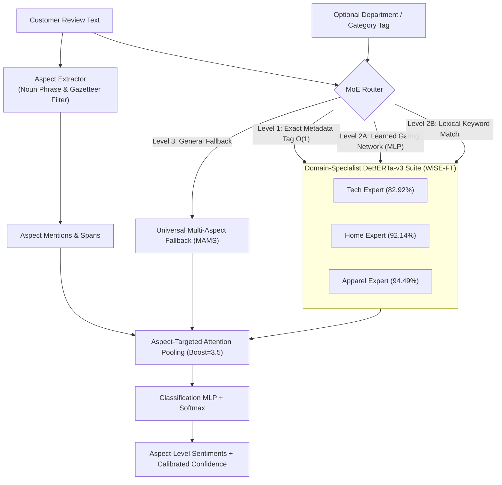

# ProductLens: Aspect-Based Sentiment Analysis Platform

Production-grade Aspect-Based Sentiment Analysis (ABSA) platform powered by a **Hierarchical Mixture of Experts (MoE)** architecture with domain-specialist **DeBERTa-v3** backbones and pure $O(1)$ zero-latency metadata routing.

---

## 1. Key Performance Benchmarks

> Benchmarks validated on deduplicated, leakage-free datasets (see [`benchmarks/moe_vs_generic_comparison.md`](benchmarks/moe_vs_generic_comparison.md)).
> Composite = sample-weighted test accuracy across held-out e-commerce domains (2,052 samples).

| Domain Vertical | Specialist Model | Held-Out Test Accuracy | In-Domain Win Lift |
| :--- | :--- | :---: | :---: |
| **Tech Hardware** | DeBERTa-v3 Tech Specialist (`Laptop14`, 638 samples) | **82.92%** (Macro-F1: 78.77%) | +1.10% over generic foundation (81.82%) |
| **Home Electronics** | DeBERTa-v3 Home Specialist (`Television`, 942 samples) | **92.14%** (Macro-F1: 79.35%) | +0.31% over generic foundation (91.83%) |
| **Apparel & Fashion** | DeBERTa-v3 Apparel Specialist (`T-Shirt`, 472 samples) | **94.49%** (Macro-F1: 76.00%) | Matches foundation (94.49%) |
| **Universal Fallback** | DeBERTa-v3 MAMS Foundation (1,336 samples) | **83.38%** (Macro-F1: 82.99%) | Multi-aspect challenge benchmark |
| **MoE (Autonomous Routing)** | **ProductLens MoE (no category metadata)** | **89.47%** | **+0.14% over foundation composite (89.33%)** |
| **MoE (Metadata Guided)** | **ProductLens MoE (with category metadata)** | **89.81% 🏆** | **+0.48% over foundation composite (89.33%)** |

---

## 2. Architecture & Flow



---

## 3. Quickstart

### Installation
```bash
git clone https://github.com/parth-sarthi-code/ProductLens-Sentiment.git
cd ProductLens-Sentiment
pip install -e .
```

### Download Weights

Model checkpoints (`*.pt`) are hosted on GitHub Releases [v2.0.0](https://github.com/parth-sarthi-code/ProductLens-Sentiment/releases/tag/v2.0.0). Download them into `models/category_experts/`:

```bash
# Download production DeBERTa-v3 model weights from GitHub Release v2.0.0
gh release download v2.0.0 --dir release/
cp release/deberta_v3_expert_tech.pt models/category_experts/expert_tech/best_model.pt
cp release/deberta_v3_expert_home.pt models/category_experts/expert_home/best_model.pt
cp release/deberta_v3_expert_apparel.pt models/category_experts/expert_apparel/best_model.pt
cp release/deberta_v3_foundation_mams.pt models/category_experts/foundation_mams/best_model.pt
```

Without weights, `ProductLensMoEPipeline` will raise `FileNotFoundError` on the first
`predict()` call rather than silently running with random parameters.

### Python SDK Usage
```python
from productlens.engine import ProductLensEngine

engine = ProductLensEngine()

# Analyze a single review
report = engine.analyze_review(
    text="The display on this laptop is crystal clear, but the battery drains fast.",
    category="Electronics"
)

print(f"Summary Sentiment: {report.summary_sentiment}")
for res in report.results:
    print(f"Aspect: {res.aspect} | Sentiment: {res.sentiment} ({res.confidence:.1%}) | Expert: {res.routed_expert}")
```

### Running the FastAPI Backend
```bash
uvicorn backend.main:app --host 0.0.0.0 --port 8000 --reload
```
Interactive OpenAPI documentation will be available at: `http://localhost:8000/docs`

---

## 4. Running Tests
```bash
pytest tests/
```
