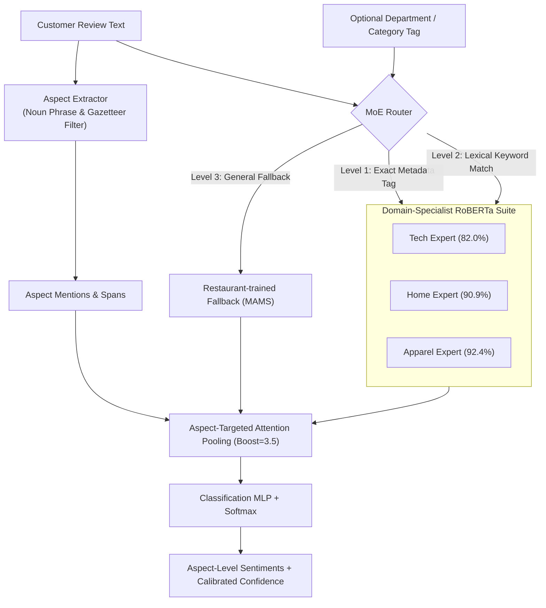

# ProductLens: Aspect-Based Sentiment Analysis Platform

Production-grade Aspect-Based Sentiment Analysis (ABSA) platform powered by a **Hierarchical Mixture of Experts (MoE)** architecture with domain-specialist RoBERTa backbones and pure $O(1)$ zero-latency metadata routing.

---

## 1. Key Performance Benchmarks

> Benchmarks generated from `scripts/evaluate_comparison.py` after deduplication and stratified retraining.
> Composite = sample-weighted test accuracy across held-out e-commerce domains.

| Domain Vertical | Specialist Model | Held-Out Test Accuracy | In-Domain Win Lift |
| :--- | :--- | :---: | :---: |
| **Tech Hardware** | RoBERTa Tech Specialist (`Laptop14`, 638 samples) | **81.97%** | +8.93% over foundation |
| **Home Electronics** | RoBERTa Home Specialist (`Television`, 942 samples) | **90.87%** | +12.31% over foundation |
| **Apparel & Fashion** | RoBERTa Apparel Specialist (`T-Shirt`, 472 samples) | **92.37%** | +4.23% over foundation |
| **Restaurant Fallback** | RoBERTa MAMS Foundation (1,336 samples) | **82.49%** | Multi-aspect challenge benchmark |
| **MoE (no category)** | **ProductLens MoE (Autonomous Routing)** | **82.12%** | **+3.07% absolute gain** |
| **E-Commerce Composite** | **ProductLens MoE (Metadata Guided)** | **88.45% 🏆** | **+9.40% absolute gain** |

---

## 2. Architecture & Flow



---

## 3. Quickstart

### Installation
```bash
git clone https://github.com/parth-sarthi-code/ProductLens-Sentiment.git
cd ProductLens-Sentiment
pip install -e .
```

### Download Weights

Model checkpoints (`*.pt`) are excluded from git. Download them before running inference or evaluation:

```bash
# Example — adapt to your actual hosting location (HF Hub / cloud storage)
python scripts/download_weights.py  # or follow project-specific instructions
```

Without weights, `ProductLensMoEPipeline` will raise `FileNotFoundError` on the first
`predict()` call rather than silently running with random parameters.

### Python SDK Usage
```python
from productlens.engine import ProductLensEngine

engine = ProductLensEngine()

# Analyze a single review
report = engine.analyze_review(
    text="The display on this laptop is crystal clear, but the battery drains fast.",
    category="Electronics"
)

print(f"Summary Sentiment: {report.summary_sentiment}")
for res in report.results:
    print(f"Aspect: {res.aspect} | Sentiment: {res.sentiment} ({res.confidence:.1%}) | Expert: {res.routed_expert}")
```

### Running the FastAPI Backend
```bash
uvicorn backend.main:app --host 0.0.0.0 --port 8000 --reload
```
Interactive OpenAPI documentation will be available at: `http://localhost:8000/docs`

---

## 4. Running Tests
```bash
pytest tests/
```
