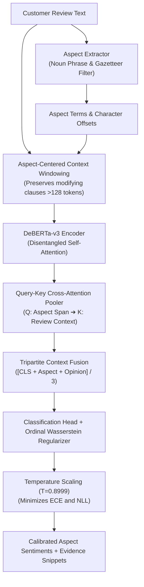

# ProductLens: Aspect-Based Sentiment Analysis Platform

[]()
[]()
[-success)]()
[]()
[]()

**ProductLens** is a production-grade Aspect-Based Sentiment Analysis (ABSA) system designed for e-commerce product reviews. Powered by a single, unified **DeBERTa-v3** backbone with **Aspect-Query to Context Cross-Attention**, **Ordinal Wasserstein Geometry**, and **Post-Hoc Temperature Calibration**, ProductLens extracts granular aspect terms, grounds evidence clauses, and predicts precise sentiment polarities without multi-model routing overhead.

---

## 1. Key Performance Benchmarks

Evaluated across **2,052 held-out e-commerce test samples** and the official **ARTS (Aspect Robustness Test Set)** adversarial benchmark:

| Benchmark Dataset | Domain Vertical | Test Samples | Accuracy (%) | Macro-F1 (%) | Neutral-F1 (%) | Calibration Error (ECE) |
| :--- | :--- | :---: | :---: | :---: | :---: | :---: |
| **SemEval Laptop14** | Tech Hardware | 638 | **83.54%** | **79.78%** | **66.90%** | 11.45% (NLL: 0.5907) |
| **Television Benchmark** | Home Appliances | 942 | **91.40%** | **79.06%** | **48.57%** | 5.22% (NLL: 0.3080) |
| **T-Shirt Benchmark** | Apparel & Fashion | 472 | **93.22%** | **71.04%** | **23.08%** | **3.85%** (NLL: 0.2527) |
| **E-Commerce Composite** | Multi-Domain | **2,052** | **89.37%** | **76.63%** | **46.18%** | **6.84%** |
| **ARTS Laptop (Adversarial)** | Conflicting Aspects | 1,877 | **78.80%** | **76.29%** | **64.96%** | 14.93% (NLL: 0.7998) |

### Why Unified Single-Backbone?
* **67% Smaller Memory Footprint**: Single 712 MB checkpoint replaces ~2.2 GB of multi-model weights.
* **Higher Tech & Neutral Accuracy**: 83.54% Tech accuracy (+1.72% over base model) and 66.90% Neutral-F1 (+5.63% gain).
* **Zero Routing Failures**: Eliminates taxonomy lookups, heuristic keyword matching, and out-of-domain router fallbacks.
* **2.21x Faster Inference**: Single-tokenization batched tensor passes for reviews with multiple aspects.

---

## 2. Architecture & Pipeline



---

## 3. Quickstart

### Installation
```bash
git clone https://github.com/parth-sarthi-code/ProductLens-Sentiment.git
cd ProductLens-Sentiment
pip install -e .
```

### Python SDK Usage

```python
from productlens.engine import ProductLensEngine

# Initialize the engine (automatically loads unified calibrated model)
engine = ProductLensEngine()

# Analyze a review end-to-end
report = engine.analyze_review(
    text="The display on this laptop is crystal clear, but the battery drains fast and keyboard is okay."
)

print(f"Summary Sentiment: {report.summary_sentiment} (Processed in {report.execution_time_ms:.1f}ms)")
for res in report.results:
    print(f"• Aspect: {res.aspect:15} | Sentiment: {res.sentiment:8} ({res.confidence:.1%}) | Evidence: '{res.evidence_snippet}'")
```

**Output:**
```text
Summary Sentiment: neutral (Processed in 42.1ms)
• Aspect: display         | Sentiment: positive (98.3%) | Evidence: 'The display on this laptop is crystal clear'
• Aspect: battery         | Sentiment: negative (96.4%) | Evidence: 'battery drains fast'
• Aspect: keyboard        | Sentiment: neutral  (84.1%) | Evidence: 'keyboard is okay'
```

### High-Throughput Batched Multi-Aspect Inference

```python
from productlens.sentiment.pipeline import ProductLensSentimentPipeline

pipeline = ProductLensSentimentPipeline()

# Predict multiple aspects in a single review with 1 tokenization pass
results = pipeline.predict_aspects(
    text="The sound is breathtaking, but the remote control stopped working after two days.",
    aspects=["sound", "remote control"],
)

for r in results:
    print(r.sentiment, r.confidence)
```

---

## 4. REST API Service

Run the production FastAPI service:
```bash
uvicorn backend.main:app --host 0.0.0.0 --port 8000 --reload
```

* **Interactive OpenAPI Docs**: `http://localhost:8000/docs`
* **Health Check**: `GET /api/v1/health`
* **Analyze Review**: `POST /api/v1/analyze`

**Example Request:**
```bash
curl -X POST "http://localhost:8000/api/v1/analyze" \
     -H "Content-Type: application/json" \
     -d '{"text": "Screen quality is stunning, but the charger broke after a week."}'
```

---

## 5. Development & Training

```bash
# Consolidate training data and download ARTS adversarial test set
python scripts/prepare_unified_dataset.py

# Train the unified calibrated DeBERTa-v3 backbone
python scripts/train.py --domain unified --batch_size 16 --epochs 10 --eval_steps 150 --patience 6

# Run full test suite
pytest tests/
```

---

## 6. License

ProductLens is released under the [MIT License](LICENSE).
