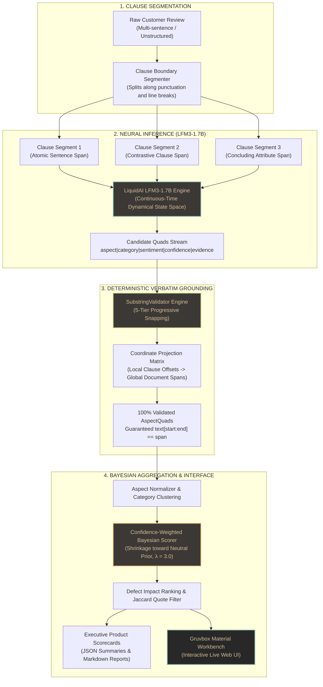

# ProductLens 3.0: Deterministic Review Intelligence and Aspect-Based Sentiment Analysis

> **A production-grade system for fine-grained product review analysis, zero-hallucination quote attribution, and Bayesian defect scoring powered by fine-tuned LiquidAI LFM3-1.7B.**

[](https://www.python.org/)
[](https://pytorch.org/)
[-success.svg)](tests)
[](https://huggingface.co/LiquidAI)
[](productlens/validator/substring.py)

---

## Overview: What ProductLens Does

E-commerce customer reviews contain detailed, high-impact feedback on individual product features. However, traditional sentiment analysis reduces an entire customer review to a single overall score (e.g., positive, negative, or a 3-star rating). This coarse approach conceals the specific reasons behind customer satisfaction or frustration. For example, a customer might write:

> *"The 4K OLED display is brilliant and color-accurate, but the battery drains in under three hours and there is noticeable gyro delay when gaming."*

An overall rating classifies this review as mixed, obscuring three distinct, highly actionable opinions about display quality, battery endurance, and sensor latency.

**ProductLens 3.0** solves this by performing end-to-end **Aspect-Based Sentiment Analysis (ABSA)**. The system takes unstructured customer feedback and extracts structured quadruples for every mentioned feature:
1. **Aspect Term:** The exact feature or component discussed (e.g., `"battery"`, `"gyro delay"`).
2. **Category:** The standardized taxonomy bucket (e.g., `BATTERY`, `PERFORMANCE`).
3. **Sentiment Polarity:** The expressed feeling (`POSITIVE`, `NEGATIVE`, `NEUTRAL`, `MIXED`) with a calibrated confidence score.
4. **Verbatim Evidence Quote:** An exact, word-for-word quote from the review that proves the sentiment, complete with validated character start and end coordinates.

Once extractions are verified, ProductLens aggregates thousands of customer reviews into Bayesian-regularized scorecards, enabling engineering, quality assurance, and product management teams to track product health and address recurring defects.

---

## Target Domains and Taxonomies

ProductLens 3.0 is built for complex, multi-attribute e-commerce verticals across consumer hardware, personal electronics, and apparel.

### 1. Electronics and Technology (`electronics_tech`)
Designed for computing hardware, consumer electronics, and mobile devices:
- **Taxonomy Categories:** `DISPLAY`, `BATTERY`, `SOUND`, `PERFORMANCE`, `BUILD_QUALITY`, `CONNECTIVITY`, `SOFTWARE`, `DELIVERY_INSTALLATION`, `VALUE`, `OTHER`.
- **Specialized Detection:** Frame rates and benchmarks (*"Bgmi 90fps, brawl stars 144fps"*), sensor behavior (*"gyro delay during gaming"*), acoustic fidelity (*"distortion at maximum volume"*), and thermal throttling.

### 2. Apparel and Fashion (`apparel_fashion`)
Designed for garments, footwear, and textile products:
- **Taxonomy Categories:** `FABRIC_MATERIAL`, `FIT_SIZING`, `COLOR_PRINT`, `STITCHING_DURABILITY`, `COMFORT`, `DELIVERY`, `VALUE`, `OTHER`.
- **Specialized Detection:** Material handfeel (*"100% combed cotton"*), post-wash behavior (*"collar shrinkage after first wash"*), cut and sizing (*"runs tight across the shoulders"*), and seam integrity.

---

## System Architecture

ProductLens 3.0 integrates continuous-time dynamical neural modeling with deterministic algorithmic verification to guarantee speed and factual precision.



### Technical Workflow in Plain Terms

1. **Clause Ingestion and Segmentation:**
   - *Technical formulation:* Raw documents are parsed along line breaks `\n+` and sentence delimiters `(?<=[.!?])\s+`, bounding input sequence lengths to $L \le 30$ tokens per segment.
   - *Why it matters:* When small language models read long reviews containing multiple distinct thoughts, their attention gets scattered. They typically remember only the beginning and the end of the text, skipping subtle complaints in the middle. Splitting the review into individual sentence clauses ensures the model evaluates each thought with full attention.

2. **Liquid Neural Inference (`LiquidAI/LFM3-1.7B`):**
   - *Technical formulation:* Instead of standard quadratic self-attention matrices, the model computes hidden states using continuous-time recurrent dynamical state-space equations governed by input-adaptive time-constants $\tau(u)$.
   - *Why it matters:* Standard AI models treat every single word with equal computational weight. Liquid models behave more like the human eye: they glide past filler words and immediately slow down and focus when encountering emotionally loaded terms like *"distorted"* or *"laggy"*. This allows a compact 1.7-billion parameter model to operate with high nuance and deliver sub-second inference on standard consumer GPUs (under 1.2 GB VRAM in 4-bit mode).

3. **Deterministic Verbatim Grounding (`SubstringValidator`):**
   - *Technical formulation:* Raw neural candidates pass through a 5-tier coordinate resolver (exact binary scan, case-insensitive normalization, punctuation trimming, collapsed whitespace matching, and clause boundary containment). Local offsets are projected back to global document coordinates.
   - *Why it matters:* Generative language models frequently hallucinate or modify quotes (for instance, changing punctuation or rewording phrases). The validator acts as a strict auditor: if a quote does not exist verbatim in the original customer review, it is rejected. Zero fabricated quotes or broken text offsets enter the database.

4. **Bayesian Aggregation and Defect Prioritization:**
   - *Technical formulation:* Individual sentiment instances are aggregated using a confidence-weighted Bayesian shrinkage formula:
     $$\hat{s}_f = \frac{\sum_{i=1}^{n_f} c_i^2 \cdot s_i + \lambda \cdot s_0}{\sum_{i=1}^{n_f} c_i^2 + \lambda}$$
     where $\lambda = 3.0$ represents a neutral prior and $c_i^2$ penalizes low-confidence extractions.
   - *Why it matters:* Simple averages can be misled by a single anomalous 1-star review (e.g., someone complaining about a damaged delivery box). Bayesian shrinkage conservatively pulls low-support complaints toward neutral until multiple independent reviews corroborate the issue. When 20 customers report the same defect, the mathematical score escalates and surfaces the issue as a top-priority fix.

5. **Linguistic Inspection Workbench:**
   - *Technical formulation:* A FastAPI web application styled in Gruvbox Material Medium Dark adhering to WCAG AA contrast standards, featuring bidirectional DOM-to-ledger span mapping.
   - *Why it matters:* Teams can visually inspect reviews in real time. Clicking or hovering over any extracted quote in the text highlights its exact category, sentiment, and confidence in the side-by-side ledger.

---

## Quickstart

### 1. Prerequisites and Installation

ProductLens requires Python 3.11+ and PyTorch 2.6+. The engine runs locally on NVIDIA consumer GPUs (tested on an RTX 4050 6GB) or in CPU fallback mode:

```bash
git clone https://github.com/your-org/ProjectLens-3.0.git
cd ProjectLens-3.0
python3 -m venv .venv
source .venv/bin/activate
pip install -e .
```

### 2. Launch the Web Workbench

To start the interactive review analysis workbench:

```bash
PYTHONPATH=. python scripts/server.py
```

Navigate to `http://localhost:8000` in your web browser. You can select pre-loaded benchmark reviews (smartphones, audio gear, ultrabooks, apparel) or paste arbitrary customer reviews for immediate multi-clause analysis.

### 3. Run the Command-Line Interface

For rapid terminal-based inspection with formatted sentiment panels:

```bash
PYTHONPATH=. python scripts/test_review.py
```

### 4. Generate Product Scorecards

To process batches of customer reviews and generate executive Bayesian scorecards:

```bash
PYTHONPATH=. python scripts/demo.py
```

Generated reports are exported to `outputs/reports/` as structured JSON metrics and formatted Markdown scorecards.

### 5. Run the Test Suite

Verify that all unit, validator, and pipeline tests pass:

```bash
pytest tests/ -q
# 51 passed in ~19s (100% pass rate)
```

---

## Repository Structure

```text
ProjectLens-3.0/
├── README.md                      # Project overview and system documentation
├── docs/
│   ├── ARCHITECTURE.md            # Detailed scientific architecture and mathematical formulations
│   └── BENCHMARKS.md              # Empirical benchmark results and evaluation methodology
├── productlens/                   # Core system package
│   ├── inference/
│   │   └── engine.py              # Clause segmentation and LFM3 inference pipeline
│   ├── validator/
│   │   ├── substring.py           # 5-Tier deterministic coordinate snapping
│   │   └── compact_parser.py      # Compact serialization decoder
│   ├── schemas/
│   │   ├── enums.py               # Taxonomy definitions and sentiment states
│   │   └── quads.py               # Pydantic schemas for validated quadruples
│   ├── aggregation/
│   │   ├── engine.py              # Product-level aggregation pipeline
│   │   ├── scoring.py             # Confidence-weighted Bayesian shrinkage estimator
│   │   ├── normalizer.py          # Semantic aspect normalization and clustering
│   │   └── evidence.py            # Defect impact ranking and Jaccard quote selection
│   ├── gold/                      # Multi-domain Gold benchmark dataset (350 reviews)
│   └── evaluation/                # Strict F1, IoU overlap, and calibration metrics
├── scripts/
│   ├── server.py                  # FastAPI application and Gruvbox Material Web UI
│   ├── test_review.py             # Multi-clause interactive terminal CLI
│   ├── demo.py                    # Product-level scorecard generation script
│   ├── stage3_train_lfm3_local.py # QLoRA local training pipeline
│   └── stage3_eval_and_export.py  # Benchmark evaluation and model export harness
├── outputs/
│   ├── stage3_lfm3_merged/        # Merged bfloat16 production weights
│   ├── stage3_lfm3_lora/          # Fine-tuned adapter checkpoints
│   └── reports/                   # Generated product executive scorecards
└── tests/                         # Comprehensive unit and integration test suite
```

---

## Detailed Documentation

For in-depth mathematical formulations and evaluation data, refer to the technical documents:
- **[System Architecture (docs/ARCHITECTURE.md)](docs/ARCHITECTURE.md):** Continuous-time dynamical systems, attention entropy equations, QLoRA fine-tuning hyperparameters, and the 5-tier snapping algorithm.
- **[Benchmark Evaluation (docs/BENCHMARKS.md)](docs/BENCHMARKS.md):** 350-review multi-domain evaluations, latency profiling, and executive product scorecards.

---

## License

This project is licensed under the Apache 2.0 License.
