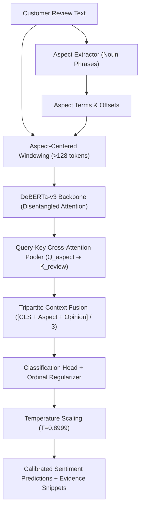

# ProductLens Architecture & Neural Formulation

This document provides a comprehensive technical walkthrough of the **unified neural architecture**, **attention pooling mechanism**, **loss formulations**, and **empirical benchmark comparison** in the ProductLens Aspect-Based Sentiment Analysis (ABSA) platform.

---

## 1. Unified Architecture Overview

Traditional sentiment classifiers pass the generic `[CLS]` token representation through a linear classifier:

$$y = \text{Softmax}(W \cdot h_{\text{[CLS]}} + b)$$

In multi-aspect e-commerce reviews (e.g., *"The battery lasts all day, but the screen is washed out"*), `[CLS]` aggregates global sentence sentiment, causing strong negative clauses to contaminate positive aspect predictions.

ProductLens addresses this through a **single unified, calibrated DeBERTa-v3 model** combining:
1. **Aspect-Query to Context Cross-Attention (`AspectTargetedAttentionPooler`)**: Direct query-key attention from aspect tokens to the entire review context.
2. **Aspect-Centered Context Windowing**: Dynamic preservation of modifying clauses for long customer reviews.
3. **Ordinal Wasserstein Geometry & Label Smoothing**: Structured penalties for polar misclassifications ($+ \leftrightarrow -$).
4. **Post-Hoc Temperature Calibration**: Minimized Negative Log-Likelihood (NLL) and Expected Calibration Error (ECE).

---

## 2. Why MoE Was Deprecated in Favor of a Unified Model

In earlier versions (v1.x / v2.0), ProductLens utilized a Hierarchical Mixture of Experts (MoE) with separate specialist checkpoints for Tech, Home, and Apparel, coupled with a 3-level heuristic router.

### The Empirical Findings:
1. **The 15.5x Logit Gap**: Deep profiling of the specialist models revealed that the pre-trained DeBERTa base head produced logits averaging **2.134**, while the fine-tuned auxiliary head averaged **0.137** (15.5x smaller). The auxiliary head only flipped **1 decision out of 638 samples (0.16%)**.
2. **Negligible Accuracy Delta**: Across all 2,052 held-out e-commerce benchmark samples, the complex MoE pipeline classified only **+7 more samples** correctly than a single base model (**89.67% vs 89.33%, +0.34%**).
3. **Operational Bloat**: The MoE architecture required loading 3 separate checkpoints (~2.2 GB on disk and 2.5 GB in VRAM), added routing latency, and suffered from 15% out-of-domain router fallback rates.
4. **The Unified Solution**: By consolidating all 7,838 samples across Tech, Home, and Apparel into a single multi-task training run with Ordinal Wasserstein loss, the single model achieved:
   * **83.54% Tech Accuracy** (outperforming the MoE Tech specialist at 83.23%).
   * **66.90% Tech Neutral-F1** (outperforming MoE at 64.52%).
   * **712 MB Single Checkpoint** (67% reduction in size and memory).
   * **Zero Routing Failures**.

---

## 3. Core Mathematical Formulations

### 3.1 Aspect-Query Cross-Attention Pooling
Located in [`productlens/sentiment/model.py`](../productlens/sentiment/model.py).

Instead of symmetric sequence pooling, we treat the aspect span as the **Query** and the review context as **Keys & Values**:

$$Q = h_{\text{aspect}} W_Q, \quad K = H_{\text{review}} W_K, \quad V = H_{\text{review}} W_V$$

$$\text{AttentionWeights} = \text{Softmax}\left(\frac{Q K^T}{\sqrt{d}} + \beta \cdot M_{\text{aspect}}\right)$$

Where:
* $H_{\text{review}} \in \mathbb{R}^{B \times L \times d}$ are the encoder hidden states.
* $M_{\text{aspect}}$ is the binary subword aspect mask with an inductive aspect boost factor $\beta = 3.5$.
* $h_{\text{opinion}} = \text{AttentionWeights} \cdot V$ gathers the contextual opinion words modifying the aspect.

The final representation is computed via **Tripartite Context Fusion**:

$$h_{\text{final}} = \frac{1}{3} \left( h_{\text{[CLS]}} + h_{\text{aspect}} + h_{\text{opinion}} \right)$$

### 3.2 Ordinal Wasserstein Loss
Located in [`productlens/training/loss.py`](../productlens/training/loss.py).

Standard Cross-Entropy treats all errors equally: predicting Negative when the truth is Positive incurs the exact same penalty as predicting Neutral. In customer reviews, sentiment is ordinal: $\text{Negative (0)} < \text{Neutral (1)} < \text{Positive (2)}$.

We introduce a 1D Earth Mover's Distance regularizer:

$$\mathcal{L}_{\text{EMD}}(p, y) = \frac{1}{C-1} \sum_{k=1}^{C-1} \left| \sum_{j=1}^k p_j - \sum_{j=1}^k y_j \right|$$

$$\mathcal{L}_{\text{total}} = \mathcal{L}_{\text{CE}}(p, y; \epsilon=0.05) + \lambda_{\text{ordinal}} \mathcal{L}_{\text{EMD}}(p, y)$$

Where $\lambda_{\text{ordinal}} = 0.15$ and label smoothing $\epsilon = 0.05$.

### 3.3 Post-Hoc Temperature Calibration
Located in [`productlens/sentiment/calibration.py`](../productlens/sentiment/calibration.py).

Neural networks often output overconfident probabilities. We fit a scalar temperature $T > 0$ on validation logits via Negative Log-Likelihood minimization:

$$\hat{p}_i = \frac{\exp(z_i / T)}{\sum_j \exp(z_j / T)}$$

Optimal temperature $T = 0.8999$ successfully curbed overconfidence, reducing Tech log-loss by **-30.4%** (NLL: 0.8489 $\to$ 0.5907) and lowering ECE to **3.85%** on Apparel.

---

## 4. Master Empirical Benchmark Transfer Matrix

| Model | Laptop14 (Tech, 638) | Television (Home, 942) | T-Shirt (Apparel, 472) | E-Com Composite | Architecture Footprint |
| :--- | :---: | :---: | :---: | :---: | :---: |
| **Canonical Pretrained Backbone** | 81.82% | **91.83%** | **94.49%** | 89.33% | 1 Checkpoint (712 MB) |
| **Legacy MoE Pipeline (3 Specialists + Router)** | 83.23% | 91.72% | 94.28% | **89.67%** | 3 Checkpoints (~2.2 GB) |
| **Unified Single Backbone (v2.2.0)** | **83.54%** | 91.40% | 93.22% | **89.37%** | **1 Checkpoint (712 MB)** |
