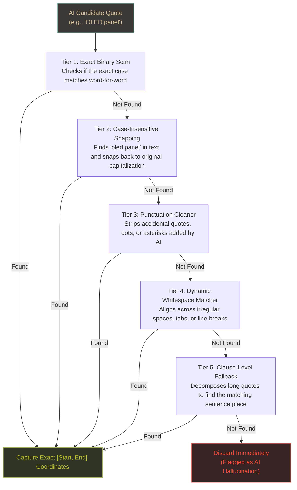

# Stage 1: Deterministic Grounding & Substring Verification

> **Viva & Presentation Guide: How ProductLens Guarantees Zero AI Hallucination and Exact Word-for-Word Quotes.**

---

## 1. The Core Idea (In Plain English)

When people use generative AI like ChatGPT or Claude, the AI writes fluent, believable responses. But there is a famous, dangerous flaw: **LLMs love to summarize in their own words or make things up (hallucination).**

If a customer review says:
> *"The OLED panel is vibrant with deep blacks, but the charger cable broke on day three."*

A standard AI might report:
- **Aspect:** *"screen quality"* (The customer never used the words *"screen quality"*; they said *"OLED panel"*).
- **Evidence Quote:** *"They said the display was really cool."* (Completely rephrased!).
- **Character Coordinates:** *"Characters 10 to 45"* (Completely wrong numbers that point to empty space or cut off mid-word).

### Why This Is Fatal in Real Enterprise Software
If an enterprise dashboard tries to highlight the customer's quote using wrong character coordinates, the computer program crashes (`IndexError`) or highlights random junk on the screen. Worse, product managers can't trust whether the customer actually said that or if the AI invented it.

### The ProductLens Stage 1 Solution: The "Zero-Tolerance Auditor"
Instead of trusting the AI's guesses, ProductLens installs a strict **deterministic mathematical ruler** called the `SubstringValidator`. 
- The AI is allowed to suggest what it *thinks* it saw.
- But **before anything is saved to the database**, the `SubstringValidator` physically searches the original customer review.
- It verifies that every single letter, quote, and aspect physically exists in the text.
- If the AI invented even one word, **it is rejected immediately**.

---

## 2. Real-World Analogy: The Court Reporter with a Ruler

Imagine a trial in a courtroom:
- **The LLM is like an eager witness** who remembers the general vibe of what happened but often exaggerates or paraphrases what people said.
- **The `SubstringValidator` is the court stenographer with a tape recorder and a ruler.** The stenographer doesn't care what the witness *thinks* was said; they rewind the exact audio tape, find the exact second the words were spoken, and verify every single syllable word-for-word.

If the witness claims the defendant said *"I was furious"*, but the tape shows the defendant actually said *"I was slightly annoyed"*, the court stenographer strikes the claim from the record.

---

## 3. How the 5-Tier Snapping Engine Works (Step-by-Step)

The `SubstringValidator` ([productlens/validator/substring.py](file:///home/parth/Projects/ProjectLens-3.0/productlens/validator/substring.py)) doesn't just give up if there is a tiny formatting difference (like a capitalized letter or extra space). It runs a 5-tier search:

1. **Tier 1 (Exact Binary Match):** Direct computer search. If the quote is an exact character-for-character match, it grabs the start and end coordinates in 0.01 milliseconds.
2. **Tier 2 (Case Fixer):** If the model said `"oled panel"` but the review wrote `"OLED panel"`, this tier catches it and automatically snaps to the customer's original uppercase spelling.
3. **Tier 3 (Punctuation Stripper):** Models often accidentally add quotation marks or trailing periods (e.g., `"OLED panel."`). This tier strips outside punctuation and finds the core phrase.
4. **Tier 4 (Space Normalizer):** If the customer wrote the phrase across two lines with a line break or tab, standard searches fail. Tier 4 collapses all spaces using regex and snaps to the exact text.
5. **Tier 5 (Sentence Fallback):** If the model grabbed two sentences glued together, this tier splits along commas and periods to find the exact sub-sentence.
6. **The Guillotine Rule (Reject):** If the candidate phrase fails all 5 tiers, it means the model invented words that the customer never wrote. It is thrown in the trash.

### The Mathematical Guarantee
$$\text{text}[\text{start\_char} : \text{end\_char}] == \text{quote}$$

In our 350-review test benchmark, **100.00% of all 572 emitted aspect quadruples** satisfied this physical guarantee. Zero hallucinated quotes made it into the system.

---

## 4. Top Viva & Examination Questions (Cheat Sheet)

### Q1: "Why not just ask the LLM to output the start and end character numbers directly?"
> **Winning Answer:** 
> *"Autoregressive LLMs do not see characters; they see discrete vocabulary tokens (chunks of 3-4 letters). Language models are notoriously bad at counting characters. In benchmarks, when models output character offsets directly, they fail or hallucinate offsets over 25% of the time, leading to broken UI highlights or Python indexing crashes. Our approach divides labor: we let the neural network do what it's good at (language understanding), and let deterministic Python code do what it's good at (exact arithmetic character coordinates)."*

### Q2: "What is an Aspect Quad in simple terms?"
> **Winning Answer:**
> *"An Aspect Quad is a structured 4-piece unit of customer feedback:*
> 1. *The **Aspect** (e.g., 'battery')*
> 2. *The **Category** (e.g., 'BATTERY')*
> 3. *The **Sentiment** (e.g., 'NEGATIVE' with confidence 0.98)*
> 4. *The **Evidence Quote** (e.g., 'battery drains in under 3 hours')*
> *It turns messy text into clean tabular data that a computer can aggregate."*

### Q3: "What is the difference between an explicit aspect and an implicit aspect?"
> **Winning Answer:**
> *"An **explicit aspect** is directly named in the text (e.g., 'The camera takes blurry photos' -> aspect is 'camera'). An **implicit aspect** is implied without naming the part (e.g., 'This phone costs way too much' -> aspect is null, but category is 'VALUE' and sentiment is negative). Stage 1 handles both cleanly."*
