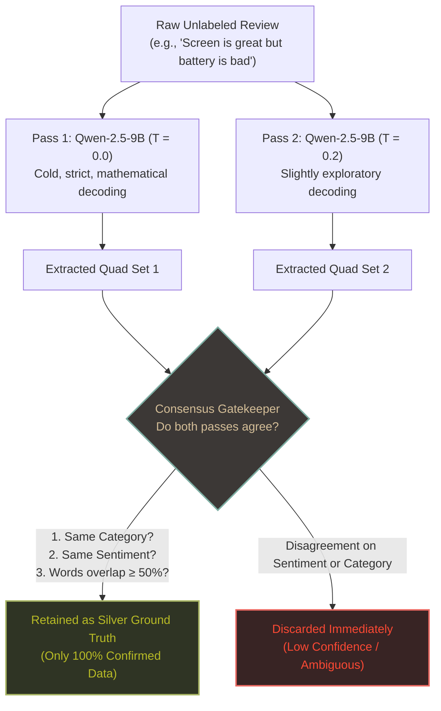

# Stage 2: Teacher Distillation & Consensus Filtering

> **Viva & Presentation Guide: How a Smart 9-Billion Parameter AI Taught Our 1.7-Billion Parameter Model Without Human Annotation Costs.**

---

## 1. The Core Idea (In Plain English)

To train a compact AI model to understand customer reviews, you need thousands of labeled examples. 

Traditionally, companies have two choices:
1. **Pay Human Annotators:** Extremely expensive and slow (costs thousands of dollars to read and highlight 5,000 reviews).
2. **Use a Big AI to Generate Labels (Single-Pass Synthetic Data):** Fast and free, but dangerous! Even large models like ChatGPT or Qwen-9B make subtle mistakes when guessing under temperature. If a large AI makes a classification mistake and you feed that mistake into your small model, the small model gets corrupted and learns bad habits permanently.

### The ProductLens Stage 2 Solution: Dual-Pass Consensus Distillation
Instead of trusting a single guess from the 9B teacher model, we force the teacher to **grade every review twice under two different mental states**:
1. **Pass 1 (Cold Logic):** Temperature $T = 0.0$ (Strict, greedy, deterministic).
2. **Pass 2 (Creative Exploration):** Temperature $T = 0.2$ (Slightly relaxed).

Then, a computer algorithm acts as a strict **consensus gatekeeper**. If the teacher's two passes agree on everything, the data point is kept. If the teacher hesitates or disagrees with itself, **the review is permanently thrown out**.

---

## 2. Real-World Analogy: The "Second Doctor's Opinion"

Imagine going to a senior medical specialist for a diagnosis:
- If the specialist gives an opinion on Monday morning when they are completely focused ($T = 0.0$), they say: *"You have a minor sprain."*
- If the specialist looks at the exact same X-ray on Friday afternoon ($T = 0.2$) and now says: *"Actually, this might be a hairline fracture"*, what should you do?
- **You should NOT trust the diagnosis.** The doctor is wavering and unsure.

Only when the doctor looks at the scan on Monday, looks at it again on Friday, and gives the **exact same diagnosis and treatment plan both times** do you trust it as 100% ground truth.

We applied this exact medical "second opinion" rule to AI labeling:

---

## 3. The 3 Consensus Rules (How It Works Technically)

For any aspect found in Pass 1 and Pass 2, it must satisfy all 3 conditions:

1. **Category Concordance:** Both passes must assign the exact same taxonomy bucket (e.g., both say `BATTERY`). If Pass 1 says `BATTERY` and Pass 2 says `PERFORMANCE`, it is rejected.
2. **Sentiment Concordance:** Both passes must assign the exact same polarity (e.g., both say `NEGATIVE`). If one pass says `NEGATIVE` and the other says `NEUTRAL`, it is rejected.
3. **Spatial Overlap (Intersection-over-Union $\ge 0.5$):** The highlighted aspect words in Pass 1 and Pass 2 must overlap by at least 50%:
   $$\text{IoU} = \frac{\text{Overlapping Characters}}{\text{Total Combined Characters}} \ge 0.5$$

When all three conditions pass:
- We keep the exact character coordinates from Pass 1.
- We set the confidence to the average of both passes: $\bar{p} = \frac{p_1 + p_2}{2}$.

### The Result:
This filter eliminated all borderline, hallucinated, or uncertain extractions. Only unambiguous, crystal-clear examples were allowed into the training dataset.

---

## 4. Top Viva & Examination Questions (Cheat Sheet)

### Q1: "What is Knowledge Distillation in simple terms?"
> **Winning Answer:**
> *"Knowledge Distillation is the process of transferring knowledge from a large, slow, expensive 'teacher' model (like a 9-billion parameter LLM) into a small, fast, efficient 'student' model (our 1.7-billion parameter Liquid model). The student learns to mimic the teacher's correct decisions while running on 15x less memory."*

### Q2: "Why did you use Qwen-2.5-9B as the teacher instead of ChatGPT-4?"
> **Winning Answer:**
> *"Three reasons:*
> 1. *Open-Weights & Reproducibility: Closed commercial APIs like GPT-4 change their weights behind the scenes, making scientific benchmarks impossible to reproduce.*
> 2. *Zero Operational Cost: Running 10,000 inference passes through an API costs significant money; Qwen-9B runs locally or on free cloud hardware (like Kaggle).*
> 3. *Data Privacy: Customer reviews remain entirely within our private pipeline without third-party API exposure."*

### Q3: "What is Temperature in language models, and why use T=0.0 and T=0.2?"
> **Winning Answer:**
> *"Temperature controls randomness. At Temperature = 0.0, the model is completely greedy—it always picks the mathematically highest-probability token with zero creativity. At Temperature = 0.2, slight randomness is introduced. If a model changes its mind about whether a review is positive or negative when given just a tiny 0.2 temperature shift, it means the model was never genuinely confident in the first place."*
