# Stage 3: Student Model Training & The Clause Attention Discovery

> **Viva & Presentation Guide: How We Fine-Tuned a 1.7-Billion Liquid AI on a Laptop GPU and Discovered the Clause Attention Breakthrough.**

---

## 1. The Core Idea (In Plain English)

In Stage 3, we had our clean training data. Now we needed to train our compact student model: **`LiquidAI/LFM3-1.7B`**.

Our goals were ambitious:
1. **Train entirely locally:** Run on a consumer laptop with an **NVIDIA GeForce RTX 4050 GPU (6 GB VRAM)** with zero cloud costs.
2. **Beat the big models:** Outperform dense models that are 5x larger while running on 15x less memory.
3. **Solve the context dilution bug:** Fix the tendency of small models to miss middle opinions when users paste long, multi-sentence reviews.

---

## 2. Why "Liquid AI" Instead of a Traditional Transformer?

Standard AI models (like GPT, BERT, or LLaMA) are built on the **Transformer** architecture. 

### The Real-World Analogy: "Camera Shutter" vs. "Human Eye"
- **Traditional Transformers (The Camera Shutter):** A standard Transformer takes a high-resolution snapshot of every single word in a sentence, and then mathematically compares every word against every other word ($O(N^2)$ quadratic complexity). If a review has 100 words, it makes $100 \times 100 = 10,000$ computations! It expends just as much energy on filler words (*"and"*, *"the"*, *"I bought this"*) as it does on important words.
- **Liquid Foundation Models (The Human Eye):** Liquid models (developed from MIT research) treat language as a continuous fluid stream. When a human reads a review, your eye glides effortlessly over filler words without spending mental energy. But the moment your eye hits a loaded word like *"distorted"* or *"overheating"*, your brain instantly slows down and locks focus. 

Liquid models do this mathematically using **Continuous-Time Dynamical State Spaces**. The internal speed of the model (called its **time-constant $\tau$**) literally adapts depending on how important the current word is. This allows a small 1.7-billion parameter model to understand subtle context better than models 5 times its size, while using only **1.2 GB of VRAM**.

---

## 3. How We Trained It Locally on a Laptop GPU

Training neural networks usually requires high-end data center GPUs ($10,000+ A100s). We achieved this on a laptop with a modest **NVIDIA RTX 4050 (6 GB VRAM)** using three engineering optimizations:

```text
Local Training Profile (scripts/stage3_train_lfm3_local.py):
-----------------------------------------------------------
Hardware:       NVIDIA GeForce RTX 4050 Laptop GPU (6 GB VRAM)
Quantization:   4-bit NormalFloat4 (NF4) with Double Quantization
Adapter:        QLoRA (Rank r=16, Alpha α=32, targeting all linear projections)
Optimizer:      paged_adamw_8bit (pages memory to RAM if VRAM spikes)
Precision:      bfloat16 native compute
Training Time:  62.2 minutes (2 complete epochs, 870 steps)
Peak VRAM:      4.27 GB (1.42 GB safe headroom, zero crashes)
Validation Loss: Dropped from 0.4820 down to 0.0468
```

---

## 4. The Core Innovation: Clause Attention Segmentation

During real-world testing, we made a discovery that became the central breakthrough of this project.

### The Problem: The "Noisy Cocktail Party" Effect
When a customer pastes a long 150-word review with 7 different bullet points:
> *"Good Camera specially selfie and main... But no ultra wide lens... Good gaming performance: Bgmi 90fps... Slightly gyro delay i faced because my primary gaming device is ipad pro... Outstanding display and battery... Great speaker... Overall outstanding purchase."*

If you feed this entire text to a compact model as one big block:
1. **The model gets overwhelmed:** Just like a person in a loud, crowded party trying to listen to someone telling 7 stories at once, the model exhibits strong **primacy and recency bias**. It catches the first thing (*"Good Camera"*) and the last thing (*"outstanding purchase"*).
2. **It drops the middle complaint:** It completely misses the subtle defect buried in the middle: *"Slightly gyro delay i faced"*.
3. **It ruins the evidence quote:** When asked for evidence for *"speaker"*, the model can't isolate the sentence and echoes the entire 150-word review back as the quote.

```mermaid
flowchart TD
    subgraph MonolithicFailure ["Failure Mode: One Giant Monolithic Block"]
        M_IN["150-Word Review (7 Mixed Topics)"]
        M_IN --> M_ATTN["Attention Dispersion Across Long Context<br/>Attention weights get diluted"]
        M_ATTN --> M_OUT["Catches only 3 aspects<br/>Misses 'gyro delay'<br/>Echoes entire 150 words as evidence"]
    end

    subgraph ClauseSuccess ["Core Innovation: Clause Attention Segmentation"]
        C_IN["150-Word Review (7 Mixed Topics)"]
        C_IN --> SPLIT["Clause Segmentation Parser<br/>Splits along newlines and sentence bounds"]
        
        SPLIT --> S1["Clause 1: Camera Optics (18 tokens)"]
        SPLIT --> S2["Clause 2: Gaming & Gyro (24 tokens)"]
        SPLIT --> S3["Clause 3: Display & Battery (12 tokens)"]
        
        S1 --> A1["100% Focused Attention -> Camera (Positive)"]
        S2 --> A2["100% Focused Attention -> Gyro Delay (Negative)"]
        S3 --> A3["100% Focused Attention -> Display (Pos), Battery (Pos)"]
        
        A1 --> PROJ["Coordinate Projection Matrix<br/>Snaps local offsets back to original review"]
        A2 --> PROJ
        A3 --> PROJ
        
        PROJ --> FINAL["8 of 8 Aspects Caught (+166% recall)<br/>Tight 1:1 Quotes ('Great speaker')"]
    end

    style MonolithicFailure fill:#382424,stroke:#ea6962,stroke-width:1px,color:#fb4934
    style ClauseSuccess fill:#2f3424,stroke:#a9b665,stroke-width:2px,color:#b8bb26
```



### The Solution: Focus on One Thought at a Time
Instead of forcing the model to read a 150-word monologue at once:
1. **Automatic Segmentation:** The engine automatically splits the review into individual sentences or clauses along punctuation (`.`, `!`, `?`) and line breaks (`\n`).
2. **Focused Inference:** Each small clause ($\le 30$ tokens) is fed to the model in isolation. 100% of the model's attention heads focus strictly on that one thought.
3. **Coordinate Projection:** Mathematical coordinate projection offsets are applied so that character positions map directly back to the original full document:
   $$\text{global\_start} = \text{local\_start} + \text{segment\_start}$$

### The Empirical Proof:
| Evaluation Dimension | Monolithic Block Input | Clause-Segmented Input | Impact |
| :--- | :---: | :---: | :--- |
| **Aspects Detected** | 3 aspects | **8 aspects** | **+166% recall** |
| **Middle Defect (`gyro delay`)** | Missed completely | **Detected (Negative, 1.00)** | Critical flaw discovered |
| **Evidence for `"speaker"`** | 150-word blob echoed | `"Great speaker"` | **1:1 Exact Evidence** |
| **Inference Latency** | 6.6 seconds (one slow pass) | **336 ms – 760 ms per clause** | Incremental real-time streaming |

---

## 5. Top Viva & Examination Questions (Cheat Sheet)

### Q1: "How did a 1.7B student model beat the 9B teacher on Aspect F1 (75.97% vs 72.90%)?"
> **Winning Answer:**
> *"Two reasons:*
> 1. *Clean Data via Consensus: The student was trained only on dual-pass consensus data where the teacher agreed with itself across temperatures. This filtered out the teacher's sloppy hallucinations.*
> 2. *Clause Segmentation: The 9B teacher was evaluated on monolithic text where long contexts cause attention dispersion. The student evaluated focused clauses, allowing it to isolate aspect boundaries with higher precision."*

### Q2: "What is QLoRA in simple terms?"
> **Winning Answer:**
> *"QLoRA stands for Quantized Low-Rank Adaptation. Instead of updating all 1.7 billion parameters in full 32-bit floating point precision (which would take 20+ GB of GPU memory), QLoRA freezes the base model in 4-bit compressed precision (taking only ~1.2 GB) and trains small adapter matrices attached to the attention layers. This reduces memory usage by over 75% with zero loss in accuracy."*

### Q3: "What is Attention Entropy Dispersion?"
> **Winning Answer:**
> *"In the self-attention formula, the denominator sums over all tokens in the sequence. When a review contains 7 unrelated topics over 180 tokens, the probability mass gets spread thin across irrelevant words. Subtle modifiers (like 'slightly gyro delay') get mathematically drowned out by dominant words (like 'Good Camera'). Bounding the sequence length to 30 tokens per clause mathematically prevents this entropy dispersion."*
