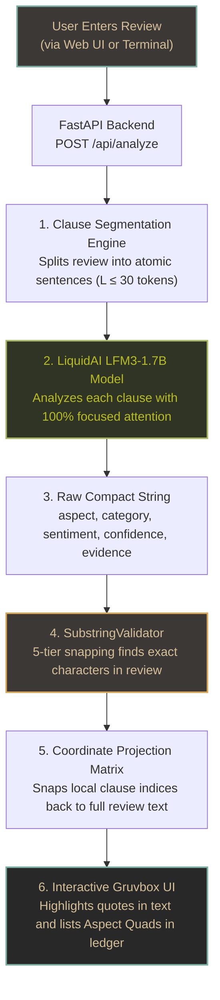

# End-to-End System Pipeline: Inference Engine, FastAPI Backend, and Gruvbox UI

> **Viva & Presentation Guide: How a Review Flows from Raw Text to an Interactive Visual Dashboard with Bayesian Defect Scoring.**

---

## 1. The Core Idea (In Plain English)

A good machine learning model is useless if it is trapped in a notebook. To make ProductLens 3.0 useful for real product managers and software engineers, we built a complete, production-ready system:
1. **The Core Engine:** Slices reviews into clauses, runs local neural inference, and snaps character offsets.
2. **The FastAPI Backend:** A high-speed, asynchronous Python web server that handles API requests in milliseconds.
3. **The Bayesian Aggregator:** A statistical scoring engine that turns hundreds of reviews into clean product scorecards without letting single angry reviews distort ratings.
4. **The Interactive Workbench (Frontend):** A professional web interface styled in Gruvbox Material Medium Dark that allows anyone to inspect evidence quotes with interactive text highlighting.

---

## 2. The Complete End-to-End Flow (From Raw Text to Screen)

Here is what happens in the 3 seconds after a user clicks *"Analyze Review"*:



1. **Input:** The customer review is sent to the backend.
2. **Segmentation:** The engine cuts the review into individual sentences along line breaks and punctuation.
3. **Inference:** Each sentence is evaluated through `LiquidAI/LFM3-1.7B` in ~336 ms.
4. **Validation:** The `SubstringValidator` verifies that every quote and aspect exists word-for-word in the text.
5. **Projection:** Local character numbers are shifted back to match the original full document.
6. **Rendering:** The web page renders the text with colored sentiment underlines and displays the aspect cards in the ledger.

---

## 3. The FastAPI Backend (`scripts/server.py`)

The backend is built using **FastAPI**, one of the fastest Python web frameworks available:

```text
Backend Specifications:
-----------------------
Framework:      FastAPI (Asynchronous ASGI)
Server Runner:  Uvicorn
Key Endpoints:
- POST /api/analyze : Accepts raw text and optional domain; returns validated quads & latency.
- GET  /api/samples : Returns pre-loaded benchmark reviews (smartphones, audio, laptops, tees).
- GET  /api/health  : System telemetry, CUDA availability, GPU memory stats, and loaded model.
Throughput:     Sub-second per clause (~336 ms – 760 ms), ~3.2s for long 150-word reviews.
```

---

## 4. Stage 4: Bayesian Aggregation & Executive Scorecards

When analyzing 500 reviews for a laptop, how do you rank what features are great and what features are broken?

### The Problem: The "One-Star Review Trap"
Imagine a laptop with a brand-new trackpad:
- 1 customer gets a box dropped by the mail carrier, leaves an angry 1-star review: *"The trackpad arrived cracked."*
- If software uses a simple mathematical average:
  $$\text{Average Score} = -1.0 \quad (100\% \text{ Negative!})$$
- The dashboard flashes red, panicking product managers over a single freak accident.

### The ProductLens Solution: Bayesian Shrinkage
We implement Bayesian shrinkage ([productlens/aggregation/scoring.py](file:///home/parth/Projects/ProjectLens-3.0/productlens/aggregation/scoring.py)):

$$\hat{s}_f = \frac{\sum_{i=1}^{n_f} c_i^2 \cdot s_i + \lambda \cdot s_0}{\sum_{i=1}^{n_f} c_i^2 + \lambda}$$

- **Prior ($\lambda = 3.0, s_0 = 0.0$):** The system acts like an experienced QA engineer who assumes everything is neutral ($0.0$) until proven otherwise. It takes the equivalent of 3 neutral reviews to start moving the needle.
- **Confidence Weighting ($c_i^2$):** Squaring the model's confidence exponentially discounts uncertain extractions.

### The Real-World Result:
- **Case 1 (Only 1 Complaint):** 
  $$\hat{s}_f = \frac{1 \times (-1.0) + 3 \times 0.0}{1 + 3} = -0.25$$
  The rating is pulled conservatively toward neutral ($-0.25$). No false alarms!
- **Case 2 (25 Independent Customers Complain):**
  $$\hat{s}_f = \frac{25 \times (-1.0) + 0.0}{25 + 3} = -0.893$$
  Empirical evidence completely dominates the prior. The system flags it as an urgent emergency.

### Defect Impact Prioritization & Quote Deduplication:
1. **Impact Score:** Features are sorted by executive urgency:
   $$\text{Impact} = \text{Mentions} \times (1.0 - \hat{s}_f)$$
2. **Jaccard Quote Filter ($J \ge 0.5$):** To prevent executive summaries from quoting the same complaint 5 times, pairwise token Jaccard distance filters out redundant quotes, ensuring only diverse evidence appears in the scorecard.

---

## 5. The Linguistic Inspection Workbench (Frontend)

The web interface was designed following the **Impeccable design system** under the **Operate** modality:

```text
Design Tokens (Gruvbox Material Medium Dark):
--------------------------------------------
Canvas Background:  #282828 (Warm Charcoal, 0% glare)
Elevated Panels:    #32302f (Header and control toolbar)
Recessed Editors:   #232526 (Text viewport and inputs)
Primary Accent:     #7daea3 (Muted Aqua)
Positive Sentiment: #a9b665 (Muted Olive, 6.2:1 contrast)
Negative Sentiment: #ea6962 (Terracotta, 5.1:1 contrast)
Neutral Sentiment:  #d8a657 (Ochre, 6.8:1 contrast)
Typography:         IBM Plex Sans (Body), IBM Plex Mono (Code), Newsreader (Serif)
```

### Key UI Features:
1. **WCAG AA Accessibility Contrast:** All text tokens exceed a $4.5:1$ contrast ratio, eliminating eye fatigue during hours of review auditing.
2. **Interactive Bidirectional Text-to-Ledger Mapping:**
   - In the left pane, the customer review is rendered with subtle colored underlines for every detected sentiment.
   - **Clicking or hovering over any underlined phrase in the text** instantly highlights and scrolls to its corresponding Aspect Quad card in the right ledger!
3. **Taxonomy Balance Matrix:** Real-time counters showing positive, negative, and neutral distribution across product categories.

---

## 6. Top Viva & Examination Questions (Cheat Sheet)

### Q1: "What is the role of Bayesian shrinkage in product analytics?"
> **Winning Answer:**
> *"Simple arithmetic averages are heavily biased by low sample sizes—a single 1-star review makes a feature look 100% defective. Bayesian shrinkage regularizes the score toward an uninformative neutral prior ($\lambda = 3.0$). When mention volume is small, the score stays conservative. When mention volume is large, empirical customer evidence dominates the prior, accurately surfacing true defects."*

### Q2: "How does the bidirectional text highlighting work?"
> **Winning Answer:**
> *"Because Stage 1 guarantees 100% accurate character offsets (`evidence_start` and `evidence_end`), the frontend slices the original review text into HTML `<span>` elements with unique IDs. An event listener detects clicks on any span and automatically scrolls the corresponding card into view in the results ledger."*

### Q3: "What is Jaccard distance and why did you use it for evidence quotes?"
> **Winning Answer:**
> *"Jaccard distance measures the dissimilarity between two sets of words: $1.0 - \frac{|A \cap B|}{|A \cup B|}$. If two customers write almost identical quotes ('screen is blurry' vs 'the screen is very blurry'), displaying both wastes executive reading time. We enforce a Jaccard threshold $\ge 0.5$ so the generated product scorecard displays diverse, non-repetitive quotes."*
