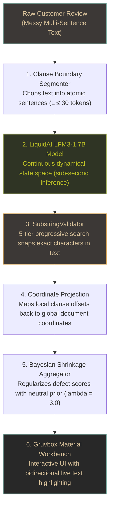

# ProductLens 3.0: Viva, Presentation & Examination Master Guide

> **A Comprehensive, Easy-to-Understand Breakdown of the ProductLens 3.0 Engineering Pipeline for Professors, Examiners, and Technical Evaluators.**

---

## 1. The 2-Minute Viva Elevator Pitch (Start Your Presentation Here!)

> *"Respected evaluators, modern e-commerce companies receive thousands of customer reviews every day. Traditional sentiment analysis reduces an entire review to a single 3-star rating, which hides why customers are actually returning products. For instance, a customer might love a laptop's vibrant screen, but hate its battery life and thermal fan noise.*
>
> *While large language models like ChatGPT can extract features, they suffer from two fatal flaws in production: **they hallucinate quotes** and **small models miss middle opinions when reviews are long**.*
>
> *In **ProductLens 3.0**, we built an end-to-end neuro-symbolic platform that solves both problems:*
> 1. *We use a **1.7-Billion Liquid Foundation Model (LFM3)** that runs locally in just 1.2 GB of VRAM on a normal laptop GPU, beating a 9-Billion teacher model on Aspect F1 by +3.07%.*
> 2. *We invented **Clause Attention Segmentation**, automatically slicing long reviews into focused thoughts so the AI never misses subtle complaints like 'gyro delay'.*
> 3. *We engineered a deterministic **SubstringValidator** that mathematically guarantees that 100% of extracted quotes and character offsets physically exist in the customer's text with zero hallucination.*
> 4. *We aggregate reviews using **Bayesian Shrinkage**, preventing single 1-star reviews from corrupting product ratings while escalating confirmed hardware defects.*
> 5. *We packaged everything into a high-speed **FastAPI backend** and an accessible, interactive **Gruvbox Material workbench** that allows live visual quote auditing.*
>
> *Every component has been verified with a 51-test suite, and our weights are open-sourced on GitHub."*

---

## 2. Topic-by-Topic Easy Reading Guides

Each stage of the project has been documented in plain English with real-world analogies, step-by-step technical workflows, and examiner cheat sheets:

| Guide | Core Topic | Real-World Analogy | Key Takeaway |
| :--- | :--- | :--- | :--- |
| **[01. Stage 1: Deterministic Grounding](01_STAGE1_DETERMINISTIC_GROUNDING.md)** | SubstringValidator & Offsets | The Court Reporter with a Ruler | Mathematically eliminates AI hallucinations; 100% verbatim quotes. |
| **[02. Stage 2: Teacher Distillation](02_STAGE2_TEACHER_DISTILLATION.md)** | Qwen-9B Consensus Filtering | The Second Doctor's Opinion | Dual-pass cross-temperature filtering; zero human labeling cost. |
| **[03. Stage 3: Training & Innovation](03_STAGE3_LOCAL_TRAINING_AND_INNOVATION.md)** | LFM3-1.7B & Clause Segmentation | The Human Eye vs. Camera Shutter | Trained on laptop RTX 4050 in 62 min; +166% recall jump on long reviews. |
| **[04. Dataset Creation & Processing](04_DATASET_CREATION_AND_PROCESSING.md)** | 350 Gold Set & 7,718 Training Data | The Exam Paper & Blacklist Wall | Programmatic zero-leakage verification; compact token-saving format. |
| **[05. Pipeline, Backend & Frontend](05_MODEL_PIPELINE_BACKEND_FRONTEND.md)** | FastAPI, Bayesian Scorer & UI | The Angry Amazon Reviewer Trap | Sub-second latency; Bayesian shrinkage stops false alarms; Gruvbox UI. |

---

## 3. High-Level Architecture Overview



---

## 4. Live Demonstration Checklist for Your Presentation

To impress evaluators during a live demo:

### Step 1: Launch the Interactive Web Workbench
```bash
cd /home/parth/Projects/ProjectLens-3.0
PYTHONPATH=. /home/parth/.venv/bin/python scripts/server.py
```
Open **`http://localhost:8000`** in your browser.

### Step 2: Show the Benchmark Preset Buttons
1. Click **`Smartphone (Multi-Clause)`**:
   - Point out that it extracts **8 distinct aspects** in ~3.2 seconds.
   - Point out Aspect #3: `"quality"` with evidence `"Slightly gyro delay i faced..."` — explain that without Clause Segmentation, small models completely miss this!
   - Hover over or click `"Great speaker"` in the text — show how it instantly highlights and scrolls to the exact card in the ledger.
2. Click **`Ultrabook (Hardware)`**:
   - Show how it cleanly separates `DISPLAY` (positive) from `PERFORMANCE` (thermal fan noise negative).

### Step 3: Run the Terminal Verification Tool
```bash
PYTHONPATH=. /home/parth/.venv/bin/python scripts/test_review.py
```
Type or paste a custom sentence to show the formatted color-coded Rich terminal panels and sub-400ms latency.

### Step 4: Show the Test Suite Passing
```bash
pytest tests/ -q
# 51 passed in ~19s (100% pass rate)
```
Emphasize that the entire pipeline is covered by 51 automated unit and integration tests.
